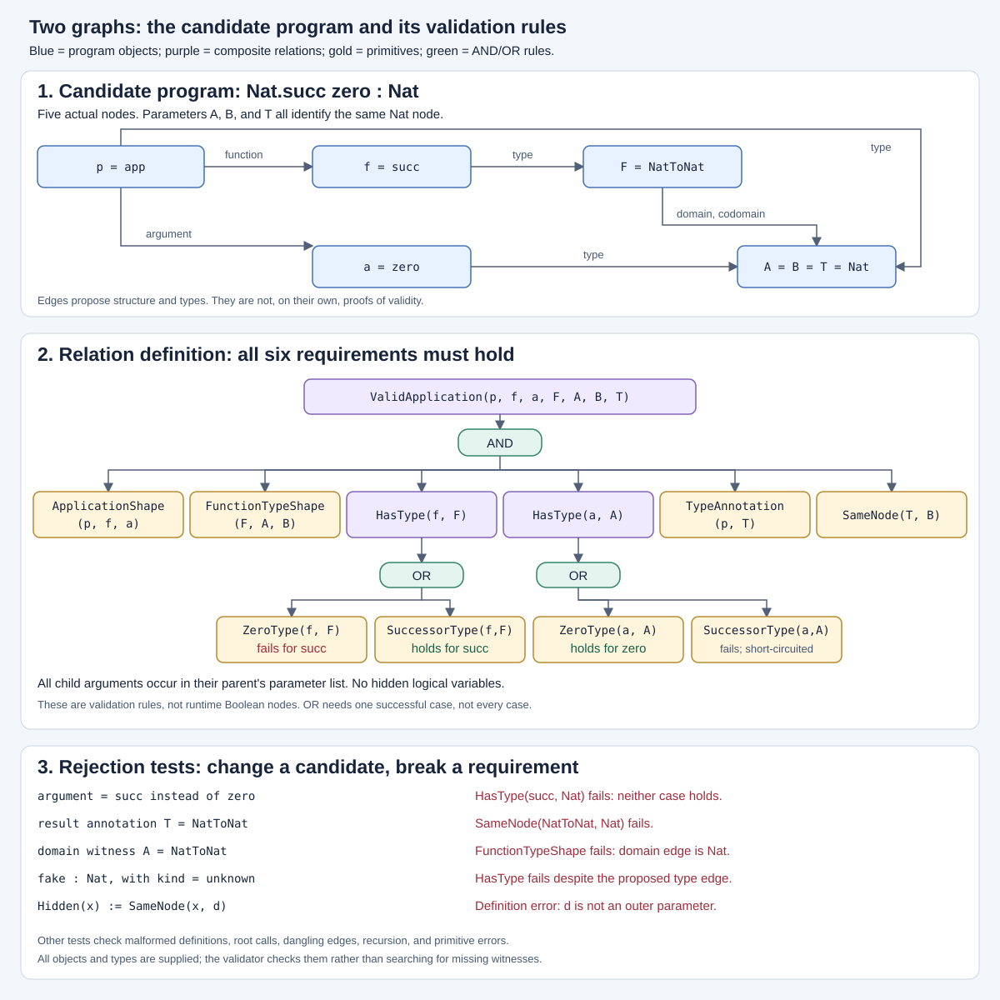
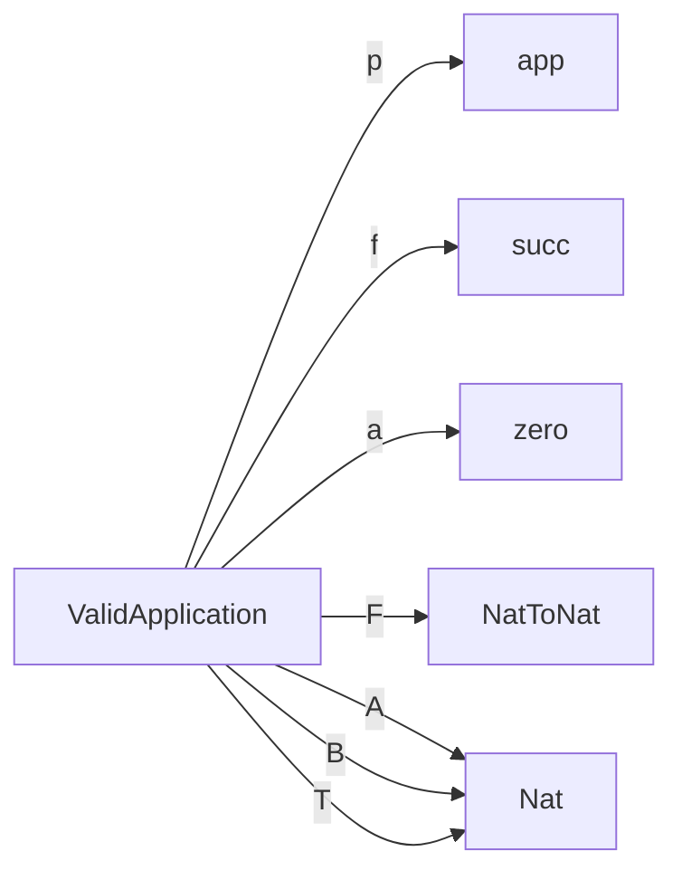
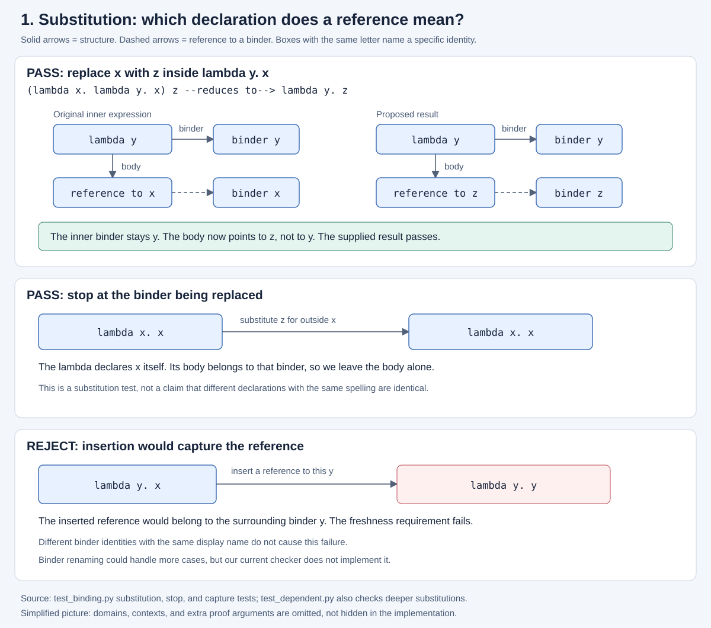
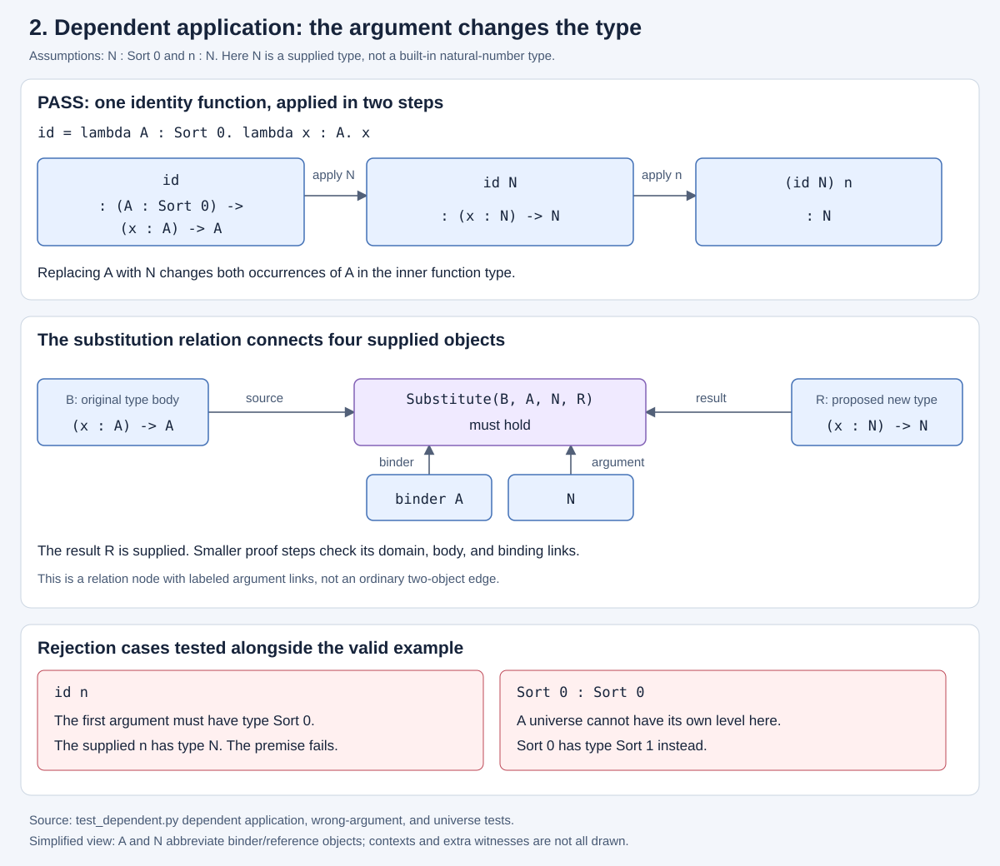
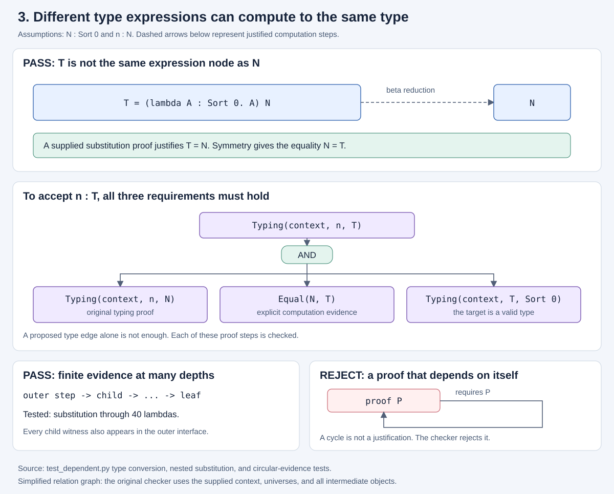
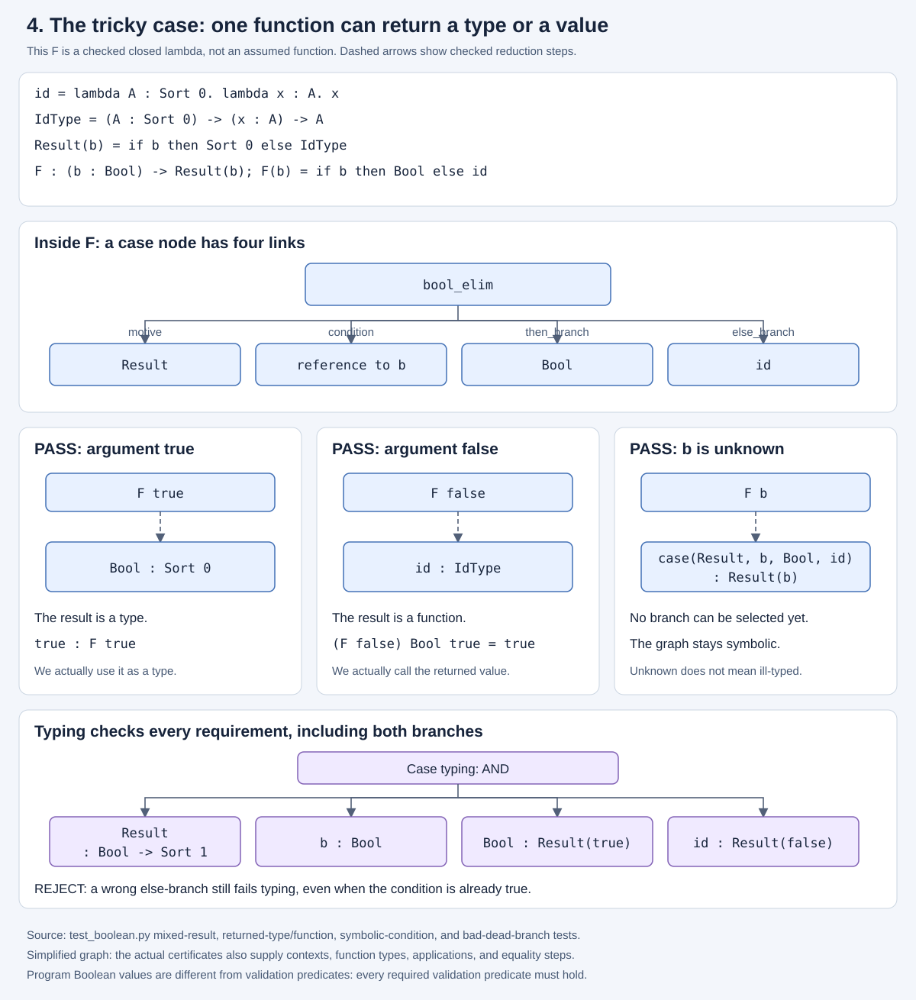

# Core idea

1. A program can be represented as a graph before it is compiled into machine
   code. That is why we think a graph is a good way to express things.
2. Our expression is a static structure: a kind of abstraction that hides
   complex computation. That is why we can see and understand it, because
   people are good at understanding cases.
3. As we express things, we also want to include computation, so we hide the
   computation behind a relation.
4. A relation is a computation, or a function, whose result is only true or
   false. When we add this relation as a requirement, we explicitly mean that
   it is true. Otherwise, we have an error.

Together, we create a graph expression with:

1. Static structure.
2. Relations as computation.

Our goal is that this kind of graph can express anything. This does not mean
that every computation can always be checked to completion.

---

## Explicit-parameter relations for program graphs

## 1. Goal

Describe a language through program graphs and mandatory relationships over
their nodes. A graph is accepted only when every required relationship holds.
The results of these checks are not Boolean-valued nodes in the program.

The graph supplies candidate objects, including intermediate types or evidence.
Validation checks those candidates; it need not discover them.

This is a proposal for a declarative validation foundation, not yet a complete
parser generator, compiler, or dependent type theory.

## 2. Objects, edges, and relations

A node has an identity, a kind, and labeled outgoing edges. Distinct parameters
can identify the same node. For example, an application's argument type and
result type may both be the same `Nat` node.

An edge records proposed structure. A relation states a requirement about
objects and their relationships. A `type` edge alone does not prove typing.

Example:

```text
p --function--> f --type--> F
|                          |--domain----> A
|--argument--> a --type--> A
|                          |--codomain--> B
|--type------> T
```

The graph can contain both structural edges and proposed type annotations.
The language specification determines which combinations are valid.

## 3. Two ways to define a relation

### Composite definition

A relation consists of alternative cases (OR). Each case consists of required
relations (AND).

```text
R(x, y, z) :=
    (R1(x, y) AND R2(y, z))
    OR
    R3(x, z)
```

A case succeeds only if all its requirements hold. The relation succeeds if
at least one case succeeds. Argument order and repeated arguments matter.

### Primitive definition

A primitive is a supplied checking computation over the explicit arguments
and the graph being validated.

```text
SameNode(x, y) := primitive node-identity comparison
```

Primitives may inspect nodes and edges and use implementation-local variables.
They must return an actual Boolean, be side-effect-free, and terminate for
validation to terminate. The engine cannot prove those properties in general.
Programming errors in a primitive are errors, not ordinary relation failures.

Primitive status is a chosen abstraction boundary, not a claim that the
computation is fundamentally impossible to decompose.

## 4. Central restriction: no hidden logical variables

Every variable in a composite definition must already be an outer parameter:

```text
Variables(body) subset of Parameters(relation)
```

Allowed:

```text
R(x, y, z) := R1(x, y) OR R2(x, y, z)
```

Not allowed:

```text
R(x, y, z) := R5(x, y, z, d)
```

The latter silently introduces `d`. There is no implicit existential
quantification, witness generation, unification, or search for missing nodes.
If `d` is needed, change the interface:

```text
R(x, y, z, d) := R5(x, y, z, d)
```

Alternatively, make the relationship primitive at the existing interface.
This restriction applies at every composite definition, not just the root.
The graph is a shared explicit validation environment, so this is not a claim
that primitive computations cannot observe anything beyond their arguments.

## 5. Function application with explicit intermediate objects

For ordinary function application, expose the application, function, argument,
function type, domain, codomain, and proposed result type:

```text
ValidApplication(p, f, a, F, A, B, T) :=
    ApplicationShape(p, f, a)
    AND FunctionTypeShape(F, A, B)
    AND HasType(f, F)
    AND HasType(a, A)
    AND TypeAnnotation(p, T)
    AND SameNode(T, B)
```

There are no hidden `A`, `B`, or `F`. This simple version uses node identity for
type equality. A richer language could supply definitional equality instead.

For dependent application, the proposed substitution result is explicit too:

```text
ValidDependentApplication(p, f, a, F, x, A, B, S, T) :=
    ApplicationShape(p, f, a)
    AND PiTypeShape(F, x, A, B)
    AND HasType(f, F)
    AND HasType(a, A)
    AND Substitution(B, x, a, S)
    AND DefinitionallyEqual(T, S)
```

Here `x` is a binder, `B` may refer to it, and `S` is the proposed result of
substituting `a` for `x` in `B`. Writing these relations does not by itself
implement substitution, scope checking, or equality.

## 6. Computation and static acceptance

The specification describes accepted graphs, much as a grammar describes
accepted syntax. Computation checks that the description is satisfied.
Successful checks do not become dynamic control-flow values in the program.

This does not eliminate type-level computation. A relation checking
substitution or definitional equality may still perform substantial reduction.
Supplying all arguments does not automatically make a relation cheap or
decidable.

Likewise, OR is an alternative between static rules. It is not necessarily a
runtime conditional in the represented language.

## 7. Prototype

### Picture of the tested relations



The picture separates two levels: program nodes connected by labeled edges,
and relation calls connected by mandatory requirements or alternative cases.
Relation calls with three or more arguments are not simple binary edges.
They can be drawn as relation nodes with one labeled argument link per
parameter (an incidence representation of a hypergraph).

For example, the same `Nat` object fills the argument positions `A`, `B`, and
`T` in the successful application:



In the SVG's decomposition diagram, argument names are written inside relation
calls instead of drawing every argument link. This keeps the AND/OR structure
legible. Failure labels describe the supplied example; they are not permanent
properties of the relation kinds. The `HasType` alternatives are ordered:
the second alternative is skipped if the first succeeds.

- [relations.py](./relations.py): graph objects, primitive/composite definitions,
  definition checking, and validation with failure paths.
- [demo.py](./demo.py): validate `Nat.succ zero : Nat`.
- [test_relations.py](./test_relations.py): acceptance and rejection tests.

Run with Python 3.10 or newer; no third-party packages are needed:

```sh
python3 demo.py
python3 -m unittest -v
```

The engine rejects duplicate parameter names, unknown relations, wrong arities, hidden
parameters, dangling edges, and recursive definition dependencies. This last
restriction is deliberately conservative: recursion is future work, not an
implicit successful circular proof.

Cases and conjunctions must be nonempty in this prototype. Evaluation uses
declaration order and short-circuiting. Failed alternatives are collected for
diagnostics when no case succeeds. Primitive exceptions propagate.

The demo's `HasType` is deliberately limited: it recognizes only zero with
type `Nat`, and the successor constant with type `Nat -> Nat`. The application
relation validates an application of such recognized expressions. It is not
a general recursive type checker and does not accept a type edge as proof.
There is no parser, binder implementation, dependent typing, universe
hierarchy, type inference, or graph generation.

## 8. Trade-offs and related work

Explicit witnesses separate construction from checking and expose dependencies.
The costs are larger interfaces, potentially larger candidate graphs, and
interface changes when a decomposition needs more objects.

AND/OR relational definitions are established in logic programming and
inference systems. Unlike general Prolog/Datalog rules, this proposal forbids
body-only logical variables. Related implementations worth studying include
[SWI-Prolog](https://www.swi-prolog.org/pldoc/refman/),
[Souffle](https://souffle-lang.github.io/tutorial), and
[PLT Redex](https://docs.racket-lang.org/redex/).
These are related foundations, not claims that they implement this exact
restriction or the complete graph-first workflow.

Further design questions include controlled recursion, evidence representation,
scope and substitution, useful error explanations, and whether notation or
editors can be generated from the same specification.

## 9. First harder test: substitution and binders

The next experiment is in [binding_demo.py](./binding_demo.py), with tests in
[test_binding.py](./test_binding.py). It uses the same validator without changing
the explicit-argument rule.

```sh
python3 binding_demo.py
python3 -m unittest -v
```

We check this proposed computation:

```text
(lambda x. lambda y. x) z
    reduces to
lambda y. z
```

The graph supplies the input, the result, the binders, and the intermediate
bodies. A reference points to a binder's identity, not to its spelling.

### What we can check

- Replace a reference to `x` with the supplied argument.
- Leave a reference to a different binder unchanged.
- Stop substitution when entering the binder for `x` itself.
- Substitute beneath one other lambda whose body is a reference.
- Reject insertion of a reference that would become bound by that lambda.
- Check that a proposed beta step uses the actual function and argument edges.
- Check identity-function reductions returning either a `Nat` type node or a
  `zero` value node. These check reduction only, not the terms' types.

These are composite relations. The new primitives only check binder kinds,
reference/lambda edges, and unequal node identities. There is no primitive
substitution routine doing the whole job.

```text
SubstituteReference(e, x, a, r, target):
    e refers to target
    AND x is a binder
    AND (
        (target is x AND r is a)
        OR
        (target is not x AND r is e)
    )
```

The lambda relation also supplies the binder, old body, proposed new body,
and targets of the body and argument references. No new logical variable
appears inside a case.

### Problems this experiment exposes

1. **The interfaces grow.** Reference substitution takes 5 arguments.
   Substitution under one lambda takes 9. The beta step containing that
   substitution takes 11. All the intermediate objects remain visible, but
   the outer relation has to pass them along.
2. **Arbitrary nesting is not implemented.** The current validator rejects
   recursive relation definitions. We can describe a fixed amount of nesting,
   but cannot yet reuse one recursive definition for expressions of any depth.
   This is a limit of our prototype, not proof that the idea cannot handle it.
3. **Binding needs rules, not just links.** A reference link must point to a
   binder. We must also prevent substitution from changing which binder an
   inserted reference belongs to.
4. **Local checks are not a whole-language checker.** These relations do not
   prove that every reference in a program is in scope. They do not rename
   binders, compare separately allocated but equivalent expressions, check
   dependent types, or implement general substitution. The lambda case only
   handles reference bodies and reference arguments. An unsupported input
   fails this restricted relation; it is not necessarily an invalid program.

The tests include all 81 combinations of three reference targets, three
replacement binders, three argument references, and three result references.
They also check 162 bounded lambda combinations: three binders, three body
references, three argument references, three proposed new-body references,
and two result identities (the original lambda or a separate candidate).
Additional tests check forged witnesses, beta steps, and the current nesting
and recursion limits.

So far, the rule of making every argument explicit still works. The first
clear cost is passing more arguments through larger relations. Before moving
toward Lean, we need to decide how to handle arbitrary nesting without hiding
the important checks inside one large primitive.

## 10. A small dependent-type system

The next experiment is in [dependent.py](./dependent.py).
[dependent_demo.py](./dependent_demo.py) builds example graphs and their
evidence. [test_dependent.py](./test_dependent.py) checks valid examples and
deliberately wrong ones.

```sh
python3 dependent_demo.py
python3 -m unittest -v
```

### What is in this language?

- Universes: `Sort 0 : Sort 1`, `Sort 1 : Sort 2`, and so on.
- Contexts: lists of declarations that say which variables are available.
- References to those declarations.
- Dependent function types: `(x : A) -> B`, where `B` can refer to `x`.
- Lambdas and applications.
- Substitution in references, applications, lambda domains/bodies, and
  dependent function domains/bodies.
- Supplied equality proofs using beta reduction, symmetry, transitivity,
  reflexivity, and matching application/lambda/function-type parts.
- Type conversion: use an equality proof when two type expressions differ.

This is a small predicative calculus, not Lean's exact type theory.
Here `Sort 0` is an ordinary universe, not Lean's special `Prop`.

### A real dependent application

Assume `N : Sort 0` and `n : N`. We check:

```text
id = lambda A : Sort 0. lambda x : A. x

id       : (A : Sort 0) -> (x : A) -> A
id N     : (x : N) -> N
(id N) n : N
```

The type of `id N` is not just copied from the original function type.
We supply a substitution proof showing that replacing `A` with `N` changes
both the inner function's domain and its result type.

The test also supplies two beta steps showing that `(id N) n` equals `n`.
`N` and `n` are assumptions, not built-in natural numbers.

We also test the same assumed function:

```text
Large : Sort 1
F : (A : Sort 1) -> A

F (Sort 0) : Sort 0
F Large    : Large
```

The first application has a universe as its type, so it can be used as a type.
The second has the supplied type `Large`; the checker cannot treat `Large`
as a universe just because it is a type. We assume `F`; this example does not
construct a function that inhabits that signature.

Another test checks:

```text
n : ((lambda A : Sort 0. A) N)
```

That type expression is not the same node as `N`. A supplied beta-equality
proof explains why it can still be used as the type of `n`.

### How we handle nesting without hidden arguments

We did not allow circular relation definitions in the original engine.
Instead, the candidate now includes a finite proof graph:

```text
application typing step
    requires a function typing step
    requires an argument typing step
    requires a substitution step
        requires smaller substitution steps
```

Each step chooses a known rule and supplies its arguments and premise proofs.
The checker verifies that each premise proves exactly what its parent needs.
It rejects missing arguments, missing premises, unknown rules, and cycles.

The rule descriptions are templates. For a supplied finite proof graph, we
expand them into ordinary acyclic AND-relations for the existing validator.
Each generated parent relation includes all objects supplied by its children.
Thus, if a child needs another object `d`, the generated outer interface also
includes `d`. No new node or witness is searched for or invented.

This is an important choice: we expand the interface for each candidate proof.
We have not found a single fixed-size argument list that contains the separate
witnesses for expressions of every depth.

The first dependent application demo checks 42 distinct proof steps and
exposes 22 distinct graph objects at its root. Several argument positions can
refer to the same object. The tests check substitution through 40 nested
lambdas and typing through 6 nested lambdas; these depths are test sizes, not
hard-coded language limits. Python's recursion and memory limits still apply.

### A bug found and fixed

Our first version checked only that an inserted argument had no free reference
to the surrounding binder. That was not enough for our stricter rule that
binder identities cannot be repeated inside one context: an argument could
contain a lambda declaring that same binder identity.

A rejection test exposed this. For now, the `Fresh` relation conservatively
requires the surrounding binder identity not to occur anywhere in the
argument, including its declarations. This check is itself built from smaller
relations. It is stricter than the usual "not free" condition.

We do not rename binders yet. Some terms that a fuller system could accept
after renaming are therefore rejected here. This is a restriction of this
implementation, not a reason to reject the graph idea.

### What the result means, and what it does not mean

The example checker has no primitive that secretly performs the whole typing,
substitution, or equality check. Its primitives check node shapes, identity,
and universe-level arithmetic. The larger checks are composed from those
checks and the supplied proof steps.

The example builder does compute proposed results and build proofs. It is
separate from the checker: a mistake there must still fail validation.
It is a small witness producer, not a Lean-like elaborator.

So the idea now handles a small dependent-type system with supplied evidence.
It has not been shown to handle all of Lean. Missing pieces include binder
renaming and alpha equality, `Prop`, universe variables and cumulativity,
general user-defined inductive types and eliminators, recursive definitions and termination checks,
type inference, and proof search. Equality is checked from explicit steps;
there is no automatic complete conversion procedure.

The checker is experimental and has not been formally proved sound or
complete. The tests provide evidence for specific cases, not a mathematical
proof. Large proof graphs may also repeat checks during validation; we have
not established that this approach is efficient at Lean's scale.

## 11. The original tricky case: a type or a value

The next experiment is in [boolean_demo.py](./boolean_demo.py), with tests in
[test_boolean.py](./test_boolean.py). We add `Bool`, `true`, `false`, and
dependent Boolean case analysis to the checker in [dependent.py](./dependent.py).

```sh
python3 boolean_demo.py
python3 -m unittest -v
```

### One function, two different kinds of result

This is the function we build and check. The notation below is a description,
not source text parsed by the prototype.

```text
id = lambda A : Sort 0. lambda x : A. x
IdType = (A : Sort 0) -> (x : A) -> A

Result(b) = if b then Sort 0 else IdType

F : (b : Bool) -> Result(b)
F(b) = if b then Bool else id
```

The result types fit together: `Sort 0 : Sort 1` and `IdType : Sort 1`.
So `Result(b)` is a type in `Sort 1`, whichever case holds.

We check both applications:

```text
F true  = Bool
F true  : Sort 0       -- the result is a type

F false = id
F false : IdType       -- the result is a function value
```

Unlike the earlier assumed function `F`, this `F` is constructed as a closed
lambda. There is no assumption supplying a function with the desired behavior.
Its branches, its type, and its reduction steps all have supplied proofs.

The tests also check:

```text
true : F true

(F false) Bool true : Bool
(F false) Bool true = true
```

Thus we do not merely label one result "type" and the other "value":
we actually use the first as a type and call the second as a function.
Trying to use `F false` as the type of a new declaration is rejected.

### What a case node contains

A `bool_elim` node has four links:

```text
case
    motive      -> a function describing the result type for each Boolean
    condition   -> the Boolean expression being examined
    then_branch -> the result for true
    else_branch -> the result for false
```

The motive is the part that permits different branch types. If it is `M`,
the required relationships are:

```text
M has type (b : Bool) -> Sort u
condition has type Bool
then_branch has type M true
else_branch has type M false

therefore: case has type M condition
```

All the function types and applications mentioned here are supplied graph
objects. The typing rule checks their links and the premise proofs. Conversion
proofs connect `M true` or `M false` to the types that the branches actually
have. Neither branch is skipped during type checking, even if the condition
is already `true`.

The computation rules are separate:

```text
case(M, true,  yes, no) = yes
case(M, false, yes, no) = no
```

These are separate static cases in the relation definitions. A supplied
equality proof must use the case that matches the actual condition.

### If the Boolean is unknown

With `b : Bool` in the context:

```text
F b : Result(b)
```

is still well-typed. Neither the result nor its type has to become one of the
two branches yet. The tests verify that they stay symbolic and reject an
attempt to apply the `true` reduction rule to an unknown condition.

The `true` and `false` nodes here are values of the small programming language.
They are not the success/failure results of our validation relations.
Every required validation relation still has to hold.

### What changed in the implementation

- New primitive checks only recognize Boolean node shapes and `Sort 0`.
- New composite rules check Boolean typing and dependent case analysis.
- Substitution and freshness traverse all four case-node links.
- Equality can follow a computed condition before selecting its branch.
- An explicit weakening rule lets a previously checked term be used in a
  larger context. It checks the context extension and binder freshness; it
  does not simply trust the old type in an arbitrary context.
- The example builder produces head-reduction and conversion proofs. The
  checker independently verifies each step. This producer does not fully
  normalize lambda bodies and is not a complete conversion algorithm.

No whole typing or evaluation algorithm was added as a primitive predicate.
The existing finite-proof expansion still exposes every supplied object at
the outer relation.

The true-application typing example checks 227 distinct proof steps and
exposes 45 distinct graph objects. The false-application example checks 226
steps and also exposes 45 objects. Equality checks for their returned values
are separate. These counts describe the current examples, not a size bound.

### What this shows

Our original difficult case now works: whether the result can be used as a
type depends on the argument and on checked computation. We did not need a
different application node for each case or hide missing witnesses.

This is still not all of Lean. `Bool` is one built-in inductive type with
handwritten rules; there is no general inductive-definition generator.
Binder renaming, recursive definitions, universe variables, automatic
elaboration, and a soundness proof remain future work.

## 12. Pictures of the tested cases

These are simplified drawings of examples covered by the tests. Blue boxes
are program objects; purple boxes are relations or required checks. A picture
does not show every context or proof argument. Those objects are still
explicit in the implementation.

### Substitution and binding

Replace a reference, stop at its own binder, and reject a capturing insertion.
See the corresponding cases in [test_binding.py](./test_binding.py).



### Dependent application

Applying `id` to the type `N` changes the inner function's input and output
types. The substitution relation connects the supplied source and result.
See [test_dependent.py](./test_dependent.py).



### Computed type equality

Two different expression nodes can compute to the same type. A conversion
requires explicit equality evidence; circular evidence is not accepted.
See [test_dependent.py](./test_dependent.py).



### A type, a function, or an unknown result

`F true` returns a type, `F false` returns a callable function, and `F b` stays
symbolic when `b` is unknown. Both branches must still pass type checking.
See [test_boolean.py](./test_boolean.py).


